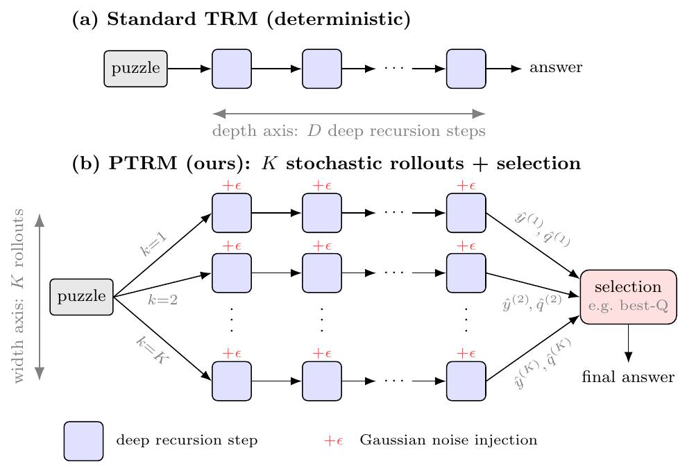

# Probabilistic Tiny Recursive Model (PTRM)

Official code for **Probabilistic Tiny Recursive Model** (NeurIPS 2026).

PTRM scales test-time compute of a trained [Tiny Recursive Model (TRM)](https://github.com/SamsungSAILMontreal/TinyRecursiveModels) by running K rollouts in parallel, adding Gaussian noise to the latent state at every supervision step so that they follow different trajectories, and selecting one answer according to a criterion (e.g., the model's existing Q head).

[](https://arxiv.org/abs/2605.19943)
[](https://amins01.github.io/ptrm)

<p align="center">
  
</p>

This repository is the original TRM code plus:

- `ptrm.py`: PTRM inference for any trained TRM checkpoint (K noisy rollouts; best-Q@K, mode@K, pass@K; Q-based halting).
- 2D rotary position embeddings (`arch.pos_encodings=rope2d`), helps for PPBench.
- Dataset builders for [Pencil Puzzle Bench](https://arxiv.org/abs/2603.02119) (`dataset/build_ppbench_*.py`, `dataset/build_multi_dataset.py`).

Training is unchanged from TRM.

## Installation

Python 3.10 and CUDA 12.6 (or similar).

```bash
pip install --upgrade pip wheel setuptools
pip install --pre --upgrade torch torchvision torchaudio --index-url https://download.pytorch.org/whl/nightly/cu126  # match your CUDA version
pip install -r requirements.txt
pip install --no-cache-dir --no-build-isolation adam-atan2  # training only
```

## PTRM inference

```bash
python ptrm.py --checkpoint <run_dir>/step_<N> --data-paths <dataset_dir> --K 100 --sigma 0.2
```

- `--checkpoint`: a trained TRM checkpoint (its `all_config.yaml` must be in the same folder)
- `--data-paths`: one or more dataset folders (evaluated on their test split)
- `--K`: number of rollouts
- `--sigma`: noise scale

The script reports best-Q@K, mode@K and pass@K for each dataset.

## Datasets

```bash
# Sudoku-Extreme
python dataset/build_sudoku_dataset.py --output-dir data/sudoku-extreme-1k-aug-1000 --subsample-size 1000 --num-aug 1000

# Maze-Hard
python dataset/build_maze_dataset.py

# ARC-AGI-2
python -m dataset.build_arc_dataset --input-file-prefix kaggle/combined/arc-agi --output-dir data/arc2concept-aug-1000 \
  --subsets training2 evaluation2 concept --test-set-name evaluation2
```

**PPBench** uses the [Pencil Puzzle Bench](https://github.com/approximatelabs/pencil-puzzle-bench) package, which needs Node.js, and its full dataset from Hugging Face:

```bash
pip install ppbench huggingface_hub
hf download bluecoconut/pencil-puzzle-bench full_dataset.jsonl --repo-type dataset \
  --local-dir $(python -c "import ppbench, os; print(os.path.dirname(ppbench.__file__))")/data
```

We train on six puzzle types (sudoku, lightup, nurikabe, shakashaka, heyawake, tapa) and report five (TRM already solves all shakashaka puzzles). Each builder writes the training and validation splits and, in `<output-dir>-golden`, the benchmark's golden set; the merge step then combines the six types into one dataset with a shared vocabulary:

```bash
python dataset/build_ppbench_sudoku.py --output-dir data/ppbench-sudoku-aug10 --num-augs 10 --val-size 100
python dataset/build_ppbench_lightup.py --output-dir data/ppbench-lightup-aug10 --num-augs 10 --val-size 100
python dataset/build_ppbench_nurikabe.py --output-dir data/ppbench-nurikabe-aug10 --num-augs 10 --val-size 100 --max-clue 30
python dataset/build_ppbench_shakashaka.py --output-dir data/ppbench-shakashaka-aug10 --num-augs 10 --val-size 100
python dataset/build_ppbench_heyawake.py --output-dir data/ppbench-heyawake-aug10 --num-augs 10 --val-size 100 --max-clue 10
python dataset/build_ppbench_tapa.py --output-dir data/ppbench-tapa-aug10 --num-augs 10 --val-size 50

types="sudoku lightup nurikabe shakashaka heyawake tapa"
python dataset/build_multi_dataset.py --output-dir data/ppbench-multi-aug10 \
  --puzzle-dirs $(for p in $types; do echo $p=data/ppbench-$p-aug10; done) \
  --golden-dirs $(for p in $types; do echo $p=data/ppbench-$p-aug10-golden; done)
```

This writes the training set (`data/ppbench-multi-aug10`, whose test split is the validation set) and one folder per puzzle type for evaluation (`data/ppbench-multi-aug10-{val,golden}-<type>`).

## Training (unchanged from TRM)

Sudoku-Extreme:

```bash
python pretrain.py arch=trm data_paths="[data/sudoku-extreme-1k-aug-1000]" evaluators="[]" \
  epochs=50000 eval_interval=5000 lr=1e-4 puzzle_emb_lr=1e-4 weight_decay=1.0 puzzle_emb_weight_decay=1.0 \
  arch.mlp_t=True arch.pos_encodings=none arch.L_layers=2 arch.H_cycles=3 arch.L_cycles=6 \
  +run_name=pretrain_mlp_t_sudoku ema=True
```

Maze-Hard:

```bash
python pretrain.py arch=trm data_paths="[data/maze-30x30-hard-1k]" evaluators="[]" \
  epochs=50000 eval_interval=5000 lr=1e-4 puzzle_emb_lr=1e-4 weight_decay=1.0 puzzle_emb_weight_decay=1.0 \
  global_batch_size=128 arch.L_layers=2 arch.H_cycles=3 arch.L_cycles=4 +run_name=pretrain_att_maze30x30_1gpu ema=True
```

PPBench:

```bash
python pretrain.py arch=trm data_paths="[data/ppbench-multi-aug10]" evaluators="[]" \
  epochs=50000 eval_interval=16 global_batch_size=512 lr=1e-4 puzzle_emb_lr=1e-4 weight_decay=1.0 puzzle_emb_weight_decay=1.0 \
  arch.pos_encodings=rope2d +run_name=pretrain_att_ppbench ema=True
```

See the [TRM repository](https://github.com/SamsungSAILMontreal/TinyRecursiveModels) for ARC-AGI and multi-GPU commands.

## Citation

```bibtex
@misc{sghaier2026probabilistictinyrecursivemodel,
      title={Probabilistic Tiny Recursive Model},
      author={Amin Sghaier and Ali Parviz and Alexia Jolicoeur-Martineau},
      year={2026},
      eprint={2605.19943},
      archivePrefix={arXiv},
      primaryClass={cs.AI},
      url={https://arxiv.org/abs/2605.19943},
}
```

This code builds on [TRM](https://github.com/SamsungSAILMontreal/TinyRecursiveModels), which is based on the [Hierarchical Reasoning Model](https://github.com/sapientinc/HRM) code.
